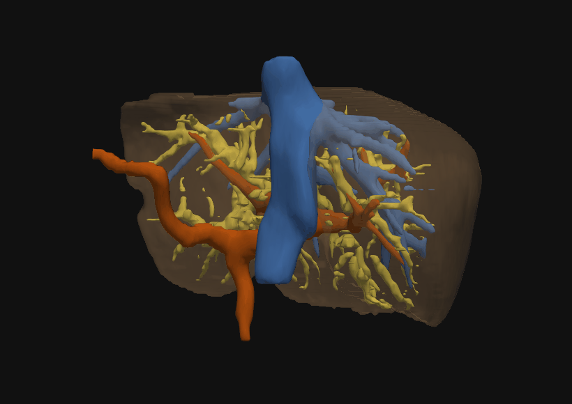
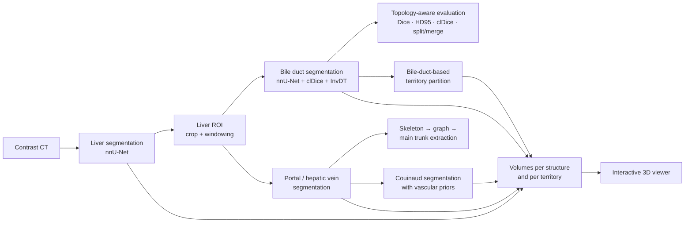
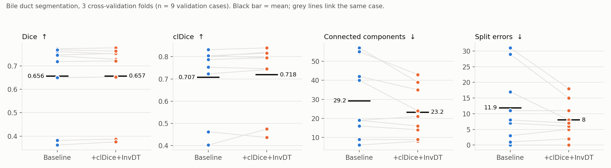
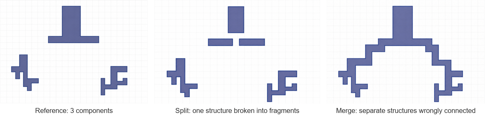
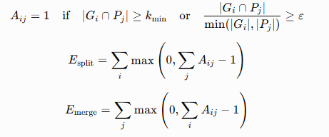
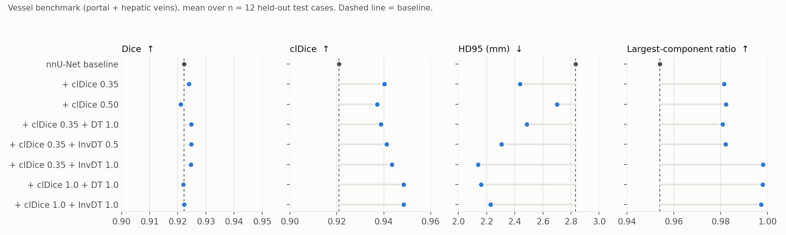
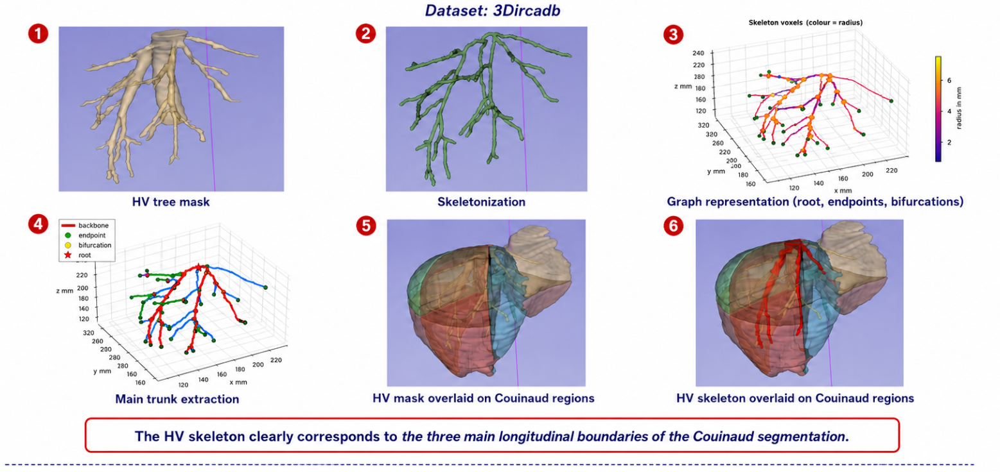
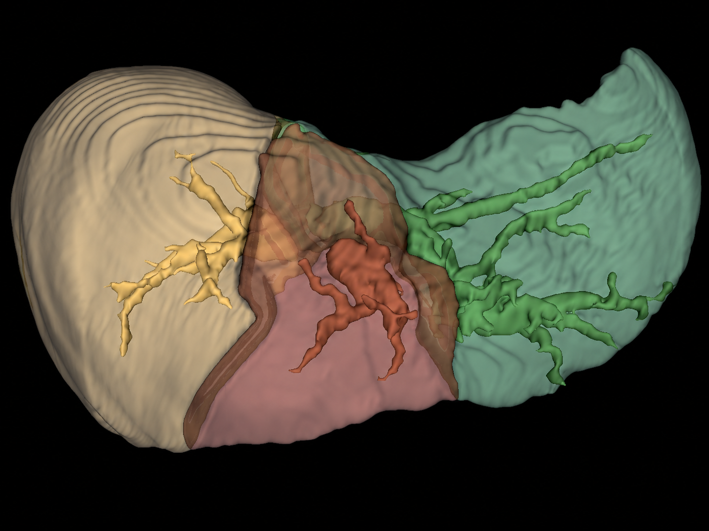
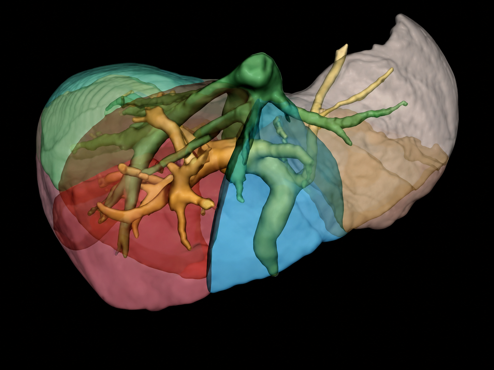
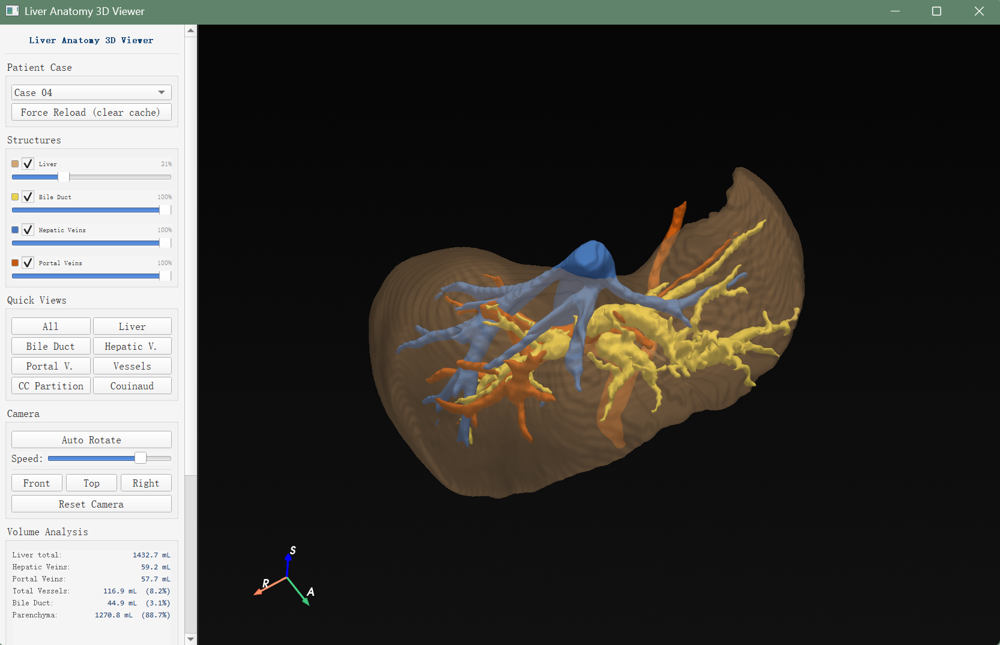

# CT-based 3D Hepatobiliary Analysis for ERCP Planning

**Liver, bile duct and hepatic vessel segmentation, topology-aware evaluation, vascular landmark extraction, liver partitioning, volumetry and an interactive 3D viewer.**

Master's research internship (M2, 2026) · BMBI laboratory, Université de Technologie de Compiègne (UTC) · ANR project **MAAGIE**, in collaboration with Saint-Antoine Hospital (AP-HP), Paris.

<p align="center">
  
  <br><em>Patient-specific reconstruction rendered from the viewer meshes: liver (transparent), bile ducts (yellow), portal vein (orange), hepatic veins (blue).</em>
</p>

---

## Why this project

ERCP (endoscopic retrograde cholangiopancreatography) is used to drain obstructed bile ducts. Before the procedure, clinicians need to understand **which bile branches are involved and how much liver they relate to**. On CT, intrahepatic bile ducts are thin, low-contrast and often only partly visible, so they are hard to segment and hard to evaluate.

This prototype builds a CT-only research pipeline that turns a contrast CT into a **multi-structure 3D model with volumes and liver territories**, and studies how far topology-aware deep learning helps on such thin tubular structures.

## What I did

| Area | My work |
|---|---|
| **Data** | Curated a bile duct CT dataset: manual 3D annotation of 10 clinical CTs and 5 public CTs in 3D Slicer (MRI reconstructions used only as anatomical reference), dataset building and splits for nnU-Net |
| **Liver & ROI** | Trained and compared nnU-Net liver models (LiTS, CRLM, combined; external test on SLIVER07), post-processing and liver-ROI preprocessing for downstream tasks |
| **Bile duct segmentation** | Implemented custom nnU-Net trainers: soft-clDice loss and an auxiliary distance-transform regression head (DT / inverted DT), plus semi-supervised and label-smoothing variants |
| **Evaluation** | Wrote a topology-aware evaluation: Dice, HD95, clDice, connected components, largest-component ratio, and **split / merge** error counts based on component matching |
| **Vessels** | Portal / hepatic vein segmentation benchmark; skeletonisation, graph construction and **main-trunk extraction** (IVC and hepatic vein trunks) |
| **Partitioning** | Couinaud segmentation with vascular prior channels; an exploratory **bile-duct-based territory partition** |
| **Volumetry & 3D viewer** | Volume and proportion computation per structure and per territory; a PyQt5 + PyVista **interactive viewer**, later reused in the lab's CPRE Pro software |

Existing methods used and adapted: nnU-Net, clDice, distance-transform supervision, SVLS. My contribution is the adaptation, implementation, experiments, analysis and integration.

## Pipeline



---

## 1. Bile duct segmentation with topology-aware losses

**Problem.** A volumetric loss such as Dice + cross-entropy barely penalises a broken branch, yet a single break changes the tree topology.

**What I implemented** ([`src/segmentation/trainer_bile_duct.py`](src/segmentation/trainer_bile_duct.py)):

- **Soft clDice loss** on the full-resolution output, which compares predicted and reference centrelines.
- An **auxiliary regression head** that predicts a (inverted) distance-transform map from the label: `1 − min(d, dmax)/dmax` inside the duct, 0 outside, trained with a foreground-weighted MSE. The extra channel is stripped at inference by a wrapper, so standard `nnUNetv2_predict` still works.
- Total loss: `DiceCE + λ_cl · clDice + λ_DT · InvDT-MSE`, with several weightings compared.
- Also explored: a consistency-regularisation semi-supervised trainer on 51 unlabeled CTs, and spatially varying label smoothing (SVLS).

**Result.** 15 manually annotated CTs, nnU-Net 3d_fullres, 300 epochs. Three cross-validation folds were completed, giving 9 validation cases:

<p align="center"></p>

Overlap (Dice) is unchanged. The topology terms reduce fragmentation on average (fewer components and split errors, higher clDice), but the per-case variation is large and merge errors slightly increase. **With 9 cases this is a trend, not a demonstrated improvement.** On CT, many small ducts are barely visible, so a topology loss cannot tell a truly absent branch from an unannotated one.

## 2. Topology-aware evaluation

Dice alone cannot tell a continuous tree from a fragmented one. In [`src/evaluation/topology_metrics.py`](src/evaluation/topology_metrics.py) I added clDice, the component count, the largest-component ratio and **split / merge errors**. Reference and predicted connected components (6-connectivity) are matched when they overlap by at least 2 voxels or 1 % of the smaller component:

<p align="center">
  <br>
  
</p>

## 3. Hepatic vessels: segmentation, graph and main trunks

**Segmentation benchmark.** Before applying the losses to bile ducts, I validated them on a better-annotated tubular task: portal and hepatic veins, 48 training and 12 held-out test CTs (MSD Task08 with VSNet re-annotation).

<p align="center"></p>

Here the topology terms behave as intended. Dice stays within 0.003 of the baseline, while clDice rises from 0.921 to up to 0.949, HD95 drops from 2.83 to 2.14 mm, and the largest-component ratio reaches 0.998. The contrast with the bile duct results is itself a finding: these losses need reasonably complete annotations to help.

**Skeleton → graph → main trunks** ([`src/vascular/`](src/vascular/)):

1. Component filtering, morphological closing and 3D Lee thinning; radius from the Euclidean distance transform.
2. Iterative leaf pruning, then conversion to a branch-level graph: bifurcation clustering, degree-2 chain contraction, small-loop removal, Savitzky–Golay smoothing, export to 3D Slicer.
3. Maximum spanning tree (edge weight = length × radius²), root selection (IVC entry for hepatic veins), greedy selection of high-score, non-overlapping root-to-leaf paths, and hierarchical level labelling.

<p align="center"></p>

On the 20 3D-IRCADb cases, a qualitative check found correct landmarks for the IVC in 18/20 cases, the left hepatic trunk in 17/20, and the middle and right trunks in 20/20. The method assumes a connected vessel tree. Fragmented predicted masks remain its main limitation.

## 4. Liver partitioning

**Couinaud segmentation with vascular priors.** I added portal and hepatic vein masks and their distance maps as extra input channels to an nnU-Net Couinaud model, using public Couinaud annotations and a fixed split (as reported in the internship report):

| Input channels | Dice | Liver accuracy | HD95 (mm) | ASSD (mm) |
|---|---|---|---|---|
| CT + liver mask | 0.859 | 0.862 | 12.98 | 2.78 |
| + PV mask | 0.872 | 0.872 | 8.60 | 2.02 |
| + PV distance map | 0.879 | 0.883 | 9.99 | 2.06 |
| **+ PV mask + PV distance map** | **0.882** | **0.885** | **7.64** | **1.84** |
| + PV & HV masks | 0.872 | 0.872 | 8.70 | 2.04 |
| + PV & HV masks and distances | 0.876 | 0.882 | 12.22 | 2.29 |

More channels are not automatically better. The portal vein mask plus its distance map gave the best trade-off.

**Bile-duct-based territories (exploratory).** The main connected components of the bile duct tree are used as seeds, and every liver voxel is assigned to the nearest seed: a Voronoi-like partition restricted to the liver ([`src/partitioning/`](src/partitioning/)). This is a **geometric** description intended to support drainage discussions. It is not a validated drainage territory.

<p align="center">
  
  &nbsp;
  
  <br><em>Left: liver territories derived from the main bile duct components. Right: Couinaud segments with portal and hepatic veins.</em>
</p>

## 5. Volumetry and interactive 3D viewer

Volumes are computed from the 3D masks: voxel count × physical voxel volume, converted to mL. This covers the liver, bile ducts, portal and hepatic veins, parenchyma, and every territory and Couinaud segment.

The viewer ([`src/visualization/viewer_3d.py`](src/visualization/viewer_3d.py), PyQt5 + PyVista) provides:

- surface extraction with per-structure smoothing and decimation
- visibility and opacity control per structure
- switching between anatomy, bile-duct territories and Couinaud views
- preset camera views and auto-rotation
- a live volume panel

<p align="center"></p>

The interface code and several of the algorithms were later reused in the lab's **CPRE Pro** software.

## 6. Liver segmentation and ROI (supporting step)

| Training data → external test SLIVER07 | Dice | Recall | HD95 (mm) |
|---|---|---|---|
| LiTS | 0.964 | 0.966 | 13.51 |
| CRLM | 0.967 | 0.957 | 4.22 |
| **LiTS + CRLM** (used downstream) | **0.972** | **0.967** | **4.20** |

For bile ducts, cropping the CT to the liver bounding box (mean Dice 0.715) worked better than masking outside the liver (0.699) or windowing alone (0.703).

---

## Limitations and lessons learned

I report these openly, because they shaped what the results can and cannot claim:

- **Small, uneven annotations.** There are 15 manually annotated bile duct CTs, and many thin ducts are not visible on CT. Clinical review of the annotations was not finished during the internship.
- **Evaluation size.** The bile duct comparison above uses the 3 completed folds (9 cases). Some loss variants were only run on a single fold of 3 cases, so they are not reported here as results.
- **Semi-supervised learning gave no overall gain.** In the separate teacher–student variant, the teacher ensemble included folds whose training data contained the student's validation cases. I treat that variant as exploratory and do not report it.
- **The territory partition is geometric**, computed in voxel index space, and not clinically validated as drainage.
- **Not done in this internship:** CT–MRI fusion; finite-element or biomechanical simulation (the viewer uses surface meshes only); a usability study with clinicians.

## Repository structure

```
.
├── README.md                 project overview (this page)
├── README_zh.md              Chinese summary
├── docs/
│   ├── RESULTS.md            all numbers with their source files and sample sizes
│   └── figures/              figures and renders used on this page
└── src/                      selected core code (patient data, weights and paths removed)
    ├── preprocessing/        liver mask cleaning, liver ROI cropping, bile duct preprocessing
    ├── segmentation/         custom nnU-Net trainers (clDice, DT/InvDT auxiliary head)
    ├── evaluation/           Dice, HD95, clDice, CC, LCC, split/merge
    ├── vascular/             skeleton → graph → main trunk extraction
    ├── partitioning/         bile-duct territories, bile duct per Couinaud segment
    └── visualization/        PyQt5 + PyVista interactive viewer
```

This repository is a **project showcase**. Patient images, annotations and trained weights are not included. The code is a curated subset of the internship code; see [`src/README.md`](src/README.md) for what each file does and what was changed for publication.

## Tech stack

Python · PyTorch · nnU-Net v2 · NumPy / SciPy · SimpleITK · NiBabel · scikit-image · NetworkX · VTK / PyVista · PyQt5 · 3D Slicer · Linux GPU server

## References

- Isensee et al., *nnU-Net: a self-configuring method for deep learning-based biomedical image segmentation*, Nature Methods, 2021.
- Shit et al., *clDice — a novel topology-preserving loss function for tubular structure segmentation*, CVPR, 2021.
- Islam & Glocker, *Spatially Varying Label Smoothing*, IPMI, 2021.
- Lee, Kashyap & Chu, *Building skeleton models via 3-D medial surface/axis thinning algorithms*, CVGIP, 1994.
- Public data: LiTS, CRLM, SLIVER07, 3D-IRCADb-01, MSD Task08 with VSNet re-annotation, public Couinaud annotations (Zhang et al.).

## Author

**Ningyuan Zhang**: M2 research intern, UTC BMBI (ANR MAAGIE).
