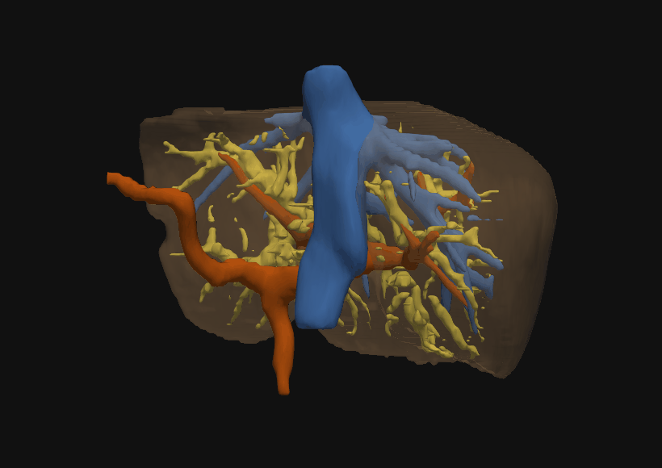

# 面向 ERCP 术前分析的 CT 肝胆三维分析

[English](README.md)

UTC BMBI 实验室 M2 科研实习（2026），ANR **MAAGIE** 项目，与巴黎 Saint-Antoine 医院（AP-HP）合作。

## 项目目标

ERCP 术前需要了解梗阻涉及哪些胆管分支，以及这些分支对应多大范围的肝脏。CT 上的肝内胆管细、对比度低、常常显示不全，所以既难分割，也难评估。本项目基于 CT 做了一套研究原型：生成肝脏、胆管和血管的多结构三维模型，计算各结构和各区域的体积，并研究拓扑约束在细管状结构上能起多大作用。

## 我的工作

- **数据**：在 3D Slicer 中人工标注 10 例临床 CT 和 5 例公开 CT 的胆管（MRI 重建只作为解剖参考），并构建 nnU-Net 数据集和划分。
- **肝脏与 ROI**：比较 LiTS、CRLM 及两者合并训练的 nnU-Net 肝脏模型，在 SLIVER07 上做外部测试；完成后处理和肝脏 ROI 预处理。
- **胆管分割**：实现自定义 nnU-Net trainer，包括 soft-clDice 损失和距离变换（DT / InvDT）辅助回归头；另外尝试了半监督和标签平滑变体。
- **评估**：实现 Dice、HD95、clDice、连通块数、最大连通块比例和 split/merge 拓扑指标。
- **血管**：完成门静脉和肝静脉分割基准；实现骨架提取、图结构构建，以及 IVC 和肝静脉主干的提取。
- **肝脏分区**：用血管先验辅助 Couinaud 分段；另做了基于胆管连通块的探索性几何分区。
- **体积与界面**：计算各结构和各区域的体积；开发 PyQt5 + PyVista 交互式三维界面，后来被实验室的 CPRE Pro 软件复用。

nnU-Net、clDice、距离监督和 SVLS 都是已有方法。我的贡献是适配、实现、实验、分析和流程集成。

## 主要结果

- **胆管**（3 折共 9 例验证病例）：Dice 基本不变（0.656 → 0.657）。clDice 略升（0.707 → 0.718），连通块和断裂数平均下降，但病例间差异很大，merge 略有增加。这只能算趋势，不能视为已证实的提升。
- **血管基准**（12 例独立测试）：Dice 与 baseline 相差不超过 0.003；clDice 从 0.921 提升到最高 0.949，HD95 从 2.83 mm 降到 2.14 mm。
- **主干提取**（3D-IRCADb，20 例）：IVC 18/20、左干 17/20、中干和右干均为 20/20（定性判断）。
- **Couinaud**：加入门静脉 mask 和距离图后效果最好，Dice 从 0.859 提升到 0.882，HD95 从 12.98 mm 降到 7.64 mm。

全部数字及其来源见 [docs/RESULTS.md](docs/RESULTS.md)。

## 局限

人工标注样本少，且临床审核尚未完成；部分变体只跑了 1 个 fold（3 例），因此不作为结果报告；半监督方法没有带来整体提升；胆管分区是体素空间中的几何划分，不代表经过验证的引流区域。实习期间没有完成 CT–MRI 融合，也没有做有限元仿真。

## 说明

本仓库是项目展示，不包含患者影像、标注和训练权重。`src/` 中是精选的核心代码，说明见 [src/README.md](src/README.md)。

作者：**张宁远（Ningyuan Zhang）**
